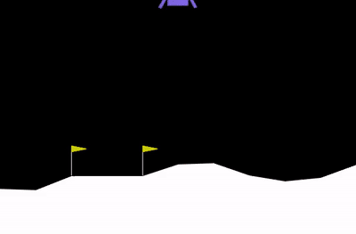
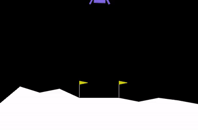
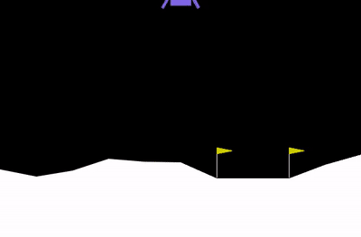

# Deep Q-Learning for Lunar Landing with a Randomized Landing Pad

A PyTorch Deep Q-Network (DQN) agent that learns to land the Gymnasium `LunarLander-v3` spacecraft on a landing pad that is **moved to a different position every episode**. The project compares standard DQN with Double DQN across multiple random seeds.

| Left pad | Center pad | Right pad |
|---|---|---|
|  |  |  |

*One saved model, three pad positions. These are single example episodes.*

## What this project does

In the standard environment the landing pad is always in the middle. Here the pad position is changed, which required three things:

1. **Patched environment.** A copy of Gymnasium's `LunarLander` source is modified so the pad can be set to `left`, `center`, `right` or `random` (a random one of 7 positions per episode).
2. **Fixed reward shaping.** The original reward measures distance to x = 0. I changed it to measure distance to the pad, otherwise the agent is rewarded for flying to the wrong place.
3. **Pad position in the observation.** A wrapper appends the pad's x-offset to the 8-value state (9 values total), so the agent can see where to land.

The agent is a DQN with experience replay, a soft-updated target network and epsilon-greedy exploration. Discount factor 0.99, learning rate 5e-4, network 9 -> 64 -> 64 -> 4.

## Results

All numbers are from the notebook. Evaluation: 500 episodes per model, greedy policy, random pad. "Landed well" = score of at least 200; "crashed" = score below 0.

**Standard DQN vs Double DQN, 3 seeds each** (mean ± standard deviation across seeds):

| | Standard DQN | Double DQN |
|---|---|---|
| Episodes to solve (100-episode average >= 200) | 929 ± 189 | **815 ± 9** |
| Mean evaluation score | 194.6 ± 39.4 | **206.4 ± 14.4** |
| Landed well | 66.3% ± 18.4 | 68.5% ± 9.8 |
| Crash rate | 7.0% ± 6.9 | **2.5% ± 1.0** |

Per-seed numbers are in [`results/results.csv`](results/results.csv).

**What the results show:** Double DQN was more *reliable*. Its three runs solved the task in nearly the same number of episodes and crashed less. It did not clearly reach a *higher peak score*: the best standard DQN run (218.8) and the best Double DQN run (222.8) are close. The gap in average score comes mostly from one weak standard DQN run (seed 3: 149.1, 15% crashes).

**Single-run example model** (`models/checkpoint_random.pth`, standard DQN, solved in 630 episodes by the notebook's counting): over 500 episodes it averaged 201.7 on the right pad and 216.6 on the left pad, with about 5% crashes on each.

## Limitations (please read)

- **Results vary between training runs.** RL training is stochastic. Re-running the notebook gives a different agent, and my own seeds ranged from 149 to 219 mean score for standard DQN. The saved models are the reproducible artifacts; re-training will give different numbers.
- **3 seeds per variant is a small sample.** The Double DQN advantage is suggestive, not statistically proven.
- **One environment, one pad-position scheme** (7 discrete positions). Wind, turbulence and other pad shapes were not tested.

## Repository contents

```
lunar_landing_dqn.ipynb   full notebook (code and outputs from the run reported above)
models/
  checkpoint_random.pth   standard DQN, single run
  checkpoint_double.pth   Double DQN, single run
  seeds/                  the 6 models from the seed experiment
results/results.csv       per-seed results table
videos/                   example landings (mp4)
assets/                   GIFs used in this README
requirements.txt
```

## Run it

The notebook is written for Google Colab (it installs Box2D with `apt-get install swig`). Open `lunar_landing_dqn.ipynb` in Colab and run the cells top to bottom. Training takes roughly 10 to 25 minutes per agent on CPU.

To load a saved model (run the setup, environment, network and agent cells first):

```python
agent = Agent(state_size, number_actions)
agent.local_qnetwork.load_state_dict(torch.load('models/checkpoint_random.pth'))
my_lander.PAD_MODE = 'random'      # 'left', 'center', 'right' or 'random'
evaluate(agent, n_episodes=100)
```

## Tech

Python, PyTorch, Gymnasium (Box2D), NumPy, pandas, Matplotlib, imageio.

## Ideas for next steps

Dueling DQN and prioritized replay, more seeds, wind and turbulence, a training-curve comparison, and a small Streamlit demo.
